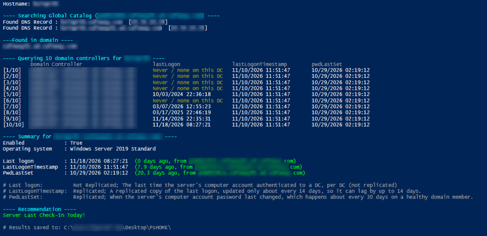

# Active Directory Object Status (Server List)

<p align="left">
  
  <br/>
</p>

✅ Reads a list of server names from `server_list.txt` on your Desktop<br>
✅ Looks each server up in Active Directory and checks every domain controller for its Last logon, LastLogonTimestamp and PwdLastSet<br>
✅ Shows Enabled status, operating system and how many days ago each date was, with age text turned orange after 30 days<br>
✅ Saves a TXT copy of the screen output and a CSV (including a **LastCheckin** "N Days" column) to `Desktop\PsHOME\`

## Code Block
```powershell
Clear-Host

# Hostname is asked first so it can be used in the script folder name
$computername  = Read-Host "Hostname"
$thresholdDays = 30   # age text and final verdict change when older than this many days

# --------------------------
# Create Script home folder
# --------------------------

# Scriptname
$ScriptName = "Active Directory Search ($computername) "

# Script home folder name and directory
$ScriptNameFull = "$($ScriptName)-$((Get-Date -Format 'MM_dd_yyyy_hhmmtt').ToLower())"
$ScriptFolder   = "$env:USERPROFILE\Desktop\PsHOME\$ScriptNameFull"

# Create script home folder, reference $ScriptFolder for storage directory
$null = New-Item -Path $ScriptFolder -ItemType directory -Force

# Use CSV or TXT and reference the names
$ResultsCSV = "$ScriptFolder\$($ScriptNameFull)-CSVResults.csv"
$ResultsTXT = "$Scriptfolder\$($ScriptNameFull)-TXTResults.txt"

# --------------------------
# Tee Write-Host to screen AND $ResultsTXT
# --------------------------
# Shadows the Write-Host cmdlet: everything printed to the screen (same colors) is also
# appended to $ResultsTXT. ANSI color codes are stripped from the file.
function Write-Host {
    [CmdletBinding()]
    param(
        [Parameter(Position = 0, ValueFromRemainingArguments = $true)]
        [object[]]$Object,
        [ConsoleColor]$ForegroundColor,
        [ConsoleColor]$BackgroundColor,
        [switch]$NoNewline,
        [object]$Separator = ' '
    )
    $text  = ($Object | ForEach-Object { "$_" }) -join $Separator
    $plain = $text -replace "$([char]27)\[[0-9;]*m", ''
    $plain = $plain -replace "(?<!`r)`n", "`r`n"
    Add-Content -Path $ResultsTXT -Value $plain -NoNewline:$NoNewline -Encoding UTF8
    Microsoft.PowerShell.Utility\Write-Host @PSBoundParameters
}

# Header at the top of the results file (the Read-Host prompt is not captured automatically)
Add-Content -Path $ResultsTXT -Encoding UTF8 -Value @(
    "Hostname : $computername"
    "Run by   : $env:USERDOMAIN\$env:USERNAME"
    "Run date : $(Get-Date -Format 'MM/dd/yyyy HH:mm:ss')"
    ('-' * 60)
)

function Convert-FT($v) {
    if ($v -and $v -ne 0 -and $v -ne 9223372036854775807) { [datetime]::FromFileTime($v) } else { $null }
}
function Show-Dt($d) { if ($d) { $d.ToString('MM/dd/yyyy HH:mm:ss') } else { 'Never / none on this DC' } }

# Writes one padded cell: white for a date, dark yellow for "Never / none on this DC"
function Write-Cell($d, $width = 26, [switch]$Last) {
    $color = if ($d) { 'White' } else { 'DarkYellow' }
    $text  = if ($Last) { Show-Dt $d } else { (Show-Dt $d).PadRight($width) }
    Write-Host $text -ForegroundColor $color -NoNewline:(-not $Last)
}

# Writes text in orange where ANSI is supported, otherwise the closest named color
function Write-Orange($text, [switch]$NoNewline) {
    if ($Host.UI.SupportsVirtualTerminal -and $Host.Name -eq 'ConsoleHost') {
        $esc = [char]27
        Write-Host "$esc[93m$text$esc[0m" -NoNewline:$NoNewline
    } else {
        Write-Host $text -ForegroundColor Yellow -NoNewline:$NoNewline
    }
}

function Get-Newest($prop) {
    $results | Where-Object { $_.$prop } | Sort-Object $prop -Descending | Select-Object -First 1
}

function Show-Line($label, $prop) {
    $r = Get-Newest $prop
    if ($r) {
        $days = [math]::Round(((Get-Date) - $r.$prop).TotalDays, 1)

        # Label and date: default console color
        Write-Host ("{0,-20}: {1}  " -f $label, (Show-Dt $r.$prop)) -NoNewline

        # Age text: default color within the threshold, orange if older
        $age = "($days days ago, from $($r.DC))"
        if ($days -le $thresholdDays) {
            Write-Host $age -ForegroundColor Green
        } else {
            Write-Orange $age
        }
    } else {
        Write-Host ("{0,-20}: Never / none on any DC" -f $label) -ForegroundColor Yellow
    }
}

# ---- Locate the computer in the entire directory (Global Catalog search) ----
$gc = (Get-ADDomainController -Discover -Service GlobalCatalog).HostName | Select-Object -First 1
Write-Host "`n---- Searching Global Catalog ($gc) ----" -ForegroundColor Cyan

# ---- DNS lookup: the short name plus "name.<each domain in the forest>" ----
$suffixes = @(
    (Get-DnsClientGlobalSetting).SuffixSearchList
    (Get-DnsClient | Where-Object ConnectionSpecificSuffix).ConnectionSpecificSuffix
    (Get-ADForest).Domains | ForEach-Object {
        # the domain itself plus every parent zone, e.g. safeway01.ad.safeway.com -> ad.safeway.com -> safeway.com
        $parts = $_ -split '\.'
        for ($k = 0; $k -le $parts.Count - 2; $k++) { $parts[$k..($parts.Count - 1)] -join '.' }
    }
) | Where-Object { $_ } | Sort-Object -Unique

$dnsCandidates = @($computername) + ($suffixes | ForEach-Object { "$computername.$_" })
$dnsHits = @()
foreach ($n in $dnsCandidates) {
    $recs = Resolve-DnsName -Name $n -Type A -DnsOnly -ErrorAction SilentlyContinue |
            Where-Object { $_.Type -eq 'A' }
    foreach ($rec in $recs) {
        $dnsHits += [pscustomobject]@{ FQDN = $rec.Name.TrimEnd('.').ToLower(); IP = $rec.IPAddress }
    }
}

if ($dnsHits.Count -gt 0) {
    foreach ($g in ($dnsHits | Sort-Object FQDN, IP -Unique | Group-Object FQDN)) {
        Write-Host "Found DNS Record : $($g.Name)  [$(($g.Group.IP) -join ', ')]"
    }
} else {
    Write-Host "No DNS Record" -ForegroundColor Magenta
}

$found = @(Get-ADComputer -Filter "Name -eq '$computername'" -Server "${gc}:3268")

if ($found.Count -eq 0) {
    Write-Host "Computer '$computername' was not found in any domain in the forest." -ForegroundColor Red
    Microsoft.PowerShell.Utility\Write-Host "`nResults saved to: $ResultsTXT" -ForegroundColor Gray
    return
}

# ---- Check each domain the computer was found in (normally just one) ----
foreach ($obj in $found) {

    $domain = ($obj.DistinguishedName -split ',' |
               Where-Object { $_ -like 'DC=*' } |
               ForEach-Object { $_ -replace '^DC=' }) -join '.'

    Write-Host ""
    Write-Host "---Found in domain ----" -ForegroundColor Cyan
    Write-Host "$domain"

    $dcs     = Get-ADDomainController -Filter * -Server $domain | Sort-Object HostName
    $total   = $dcs.Count
    $i       = 0
    $results = @()

    Write-Host "`n---- Querying $total domain controllers for $computername ----" -ForegroundColor Cyan
    Write-Host ("{0,-9}{1,-40}{2,-26}{3,-26}{4}" -f '', 'Domain Controller', 'lastLogon', 'lastLogonTimestamp', 'pwdLastSet') -ForegroundColor Gray

    foreach ($d in $dcs) {
        $i++
        $dc = $d.HostName
        Write-Host (("[{0}/{1}]" -f $i, $total).PadRight(9)) -NoNewline
        Write-Host ("{0,-40}" -f $dc) -NoNewline

        try {
            $c = Get-ADComputer -Identity $obj.DistinguishedName -Server $dc `
                 -Properties lastLogon, lastLogonTimestamp, pwdLastSet, Enabled, OperatingSystem -ErrorAction Stop

            $ll  = Convert-FT $c.lastLogon
            $llt = Convert-FT $c.lastLogonTimestamp
            $pwd = Convert-FT $c.pwdLastSet

            Write-Cell $ll
            Write-Cell $llt
            Write-Cell $pwd -Last

            $results += [pscustomobject]@{
                DC = $dc; LastLogon = $ll; LastLogonTimestamp = $llt; PwdLastSet = $pwd
                Enabled = $c.Enabled; OS = $c.OperatingSystem; Error = $null
            }
        }
        catch {
            Write-Host "Error: $($_.Exception.Message)" -ForegroundColor Red
            $results += [pscustomobject]@{
                DC = $dc; LastLogon = $null; LastLogonTimestamp = $null; PwdLastSet = $null
                Enabled = $null; OS = $null; Error = $_.Exception.Message
            }
        }
    }

    # ---- Summary ----
     Write-Host ""
    Write-Host "---- Summary for $computername ($domain) ----" -ForegroundColor Cyan
       $info = $results | Where-Object { -not $_.Error } | Select-Object -First 1
    if ($info) {
        Write-Host ("{0,-20}: {1}" -f 'Enabled', $info.Enabled)
        Write-Host ("{0,-20}: {1}" -f 'Operating system', $info.OS)
        Write-Host ""
    }

    Show-Line 'Last logon'           'LastLogon'
    Show-Line 'LastLogonTimestamp'   'LastLogonTimestamp'
    Show-Line 'PwdLastSet'           'PwdLastSet'


    Write-Host "`n# Last logon:          Not Replicated; The last time the server's computer account authenticated to a DC, per DC (not replicated)" -ForegroundColor Gray
    Write-Host "# LastLogonTimestamp:  Replicated; A replicated copy of the last logon, updated only about every 14 days, so it can lag by up to 14 days." -ForegroundColor Gray
    Write-Host "# PwdLastSet:          Replicated; When the server's computer account password last changed, which happens about every 30 days on a healthy domain member." -ForegroundColor Gray


    # ---- Final verdict ----
    # Uses the most recent activity across lastLogon, lastLogonTimestamp and pwdLastSet
    $newest = $results | ForEach-Object { $_.LastLogon, $_.LastLogonTimestamp, $_.PwdLastSet } |
              Where-Object { $_ } | Sort-Object -Descending | Select-Object -First 1

    Write-Host "`n---- Recommendation ----" -ForegroundColor Cyan
    if (-not $newest -or ((Get-Date) - $newest).TotalDays -gt $thresholdDays) {
        Write-Host "Last check-in >30days... Recommend Decommission" -ForegroundColor Magenta
    } else {
        # Days since Last logon (same rounding as the summary line), rounded up to the next whole day
        $llNewest = (Get-Newest 'LastLogon').LastLogon
        if (-not $llNewest) { $llNewest = $newest }
        $llDays = [math]::Round(((Get-Date) - $llNewest).TotalDays, 1)
        if ($llDays -le 0) {
            Write-Host "Server Last Check-In Today!" -ForegroundColor Green
        } else {
            Write-Host "Server Last Check-In < $([math]::Ceiling($llDays)) days ago" -ForegroundColor Green
        }
    }
}

# Shown on screen only (not written into the file itself)
Microsoft.PowerShell.Utility\Write-Host "`n# Results saved to: $env:USERPROFILE\Desktop\PsHOME\" -ForegroundColor Gray
```
