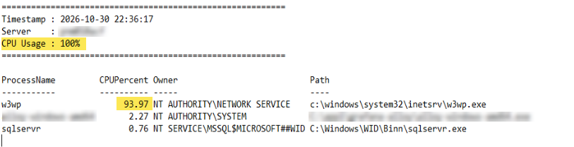

# CPU Utilization HIGH (>90%)

Continuously monitors for high CPU utilization (<90%) and writes data to log file.

<p align="left">
  
  <br/>
</p>

## Script Tasks
✅ Monitors CPU usage (5 Sec/Interval) and detects when utilization rises above 90%.<br>
✅ Captures the top 5 processes with high CPU usage.<br>
✅ Continuously logs high CPU events for later review and troubleshooting.<br>

## Script Permissions
🔴 <ins>Administrator</ins> Terminal Required!</span> 

## Code Block

```powershell
Clear-Host

# SCRIPT NAME
$ScriptName =  "High CPU Monitor"

# AM OR PM TIME INDICATOR FOR FILE AND FOLDER NAMING PURPOSES
$AmOrPm = Get-Date -UFormat %p
If ($AmOrPm -eq 'AM') { $AmPM = "am" }
ElseIf ($AmOrPm -eq 'PM') { $AmPM = "pm" }

# SCRIPT HOME FOLDER NAME AND DIRECTORY
$ScriptNameFull = "$ScriptName - $(Get-Date -f MM_dd_yyyy_hhmm)$AmPM"
$ScriptFolder = "$env:USERPROFILE\Desktop\PsHOME\$ScriptNameFull"

# CREATE SCRIPT HOME FOLDER
New-Item -Path $ScriptFolder -ItemType Directory -Force | Out-Null

# LOG FILE
$LogFile = "$ScriptFolder\HighCPU.log"

Write-Host ""
Write-Host "Monitoring CPU utilization..." -ForegroundColor Cyan
Write-Host "Log File: $LogFile" -ForegroundColor Cyan
Write-Host ""

function Get-TopProcesses {

    $Cores = (Get-CimInstance Win32_ComputerSystem).NumberOfLogicalProcessors

    Get-Counter '\Process(*)\% Processor Time' -ErrorAction SilentlyContinue |
        Select-Object -ExpandProperty CounterSamples |
        Where-Object {
            $_.Status -eq 0 -and
            $_.InstanceName -notin "_Total","Idle","System"
        } |
        Sort-Object CookedValue -Descending |
        Select-Object -First 5 |
        ForEach-Object {

            $BaseName = $_.InstanceName -replace '#\d+$',''

            $Proc = Get-Process -Name $BaseName -ErrorAction SilentlyContinue |
                    Sort-Object Id |
                    Select-Object -First 1

            if ($Proc) {

                $Owner = try {
                    $OwnerInfo = Get-CimInstance Win32_Process -Filter "ProcessId=$($Proc.Id)" |
                        Invoke-CimMethod -MethodName GetOwner

                    "$($OwnerInfo.Domain)\$($OwnerInfo.User)"
                }
                catch {
                    "Unknown"
                }

                $Path = try {
                    $Proc.MainModule.FileName
                }
                catch {
                    "Access Denied"
                }

                [PSCustomObject]@{
                    ProcessName = $_.InstanceName
                    CPUPercent  = [math]::Round(($_.CookedValue / $Cores),2)
                    Owner       = $Owner
                    Path        = $Path
                }
            }
        }
}

while ($true) {

    $CpuUsage = (
        Get-Counter '\Processor(_Total)\% Processor Time' -SampleInterval 1 -MaxSamples 5 |
        Select-Object -ExpandProperty CounterSamples |
        Select-Object -ExpandProperty CookedValue |
        Measure-Object -Average
    ).Average

    $CpuUsage = [math]::Round($CpuUsage,2)

    if ($CpuUsage -ge 90) {

        $DateTime = Get-Date -Format 'yyyy-MM-dd HH:mm:ss'

        Add-Content -Path $LogFile -Value ""
        Add-Content -Path $LogFile -Value "=========================================================="
        Add-Content -Path $LogFile -Value "Timestamp : $DateTime"
        Add-Content -Path $LogFile -Value "Server    : $env:COMPUTERNAME"
        Add-Content -Path $LogFile -Value "CPU Usage : $CpuUsage%"
        Add-Content -Path $LogFile -Value "=========================================================="

        Get-TopProcesses |
            Format-Table -AutoSize |
            Out-String |
            Add-Content -Path $LogFile

        Add-Content -Path $LogFile -Value ""

        Write-Host "$DateTime - High CPU detected ($CpuUsage%). Logged to file." -ForegroundColor Red
    }

    Start-Sleep -Seconds 5
}
```