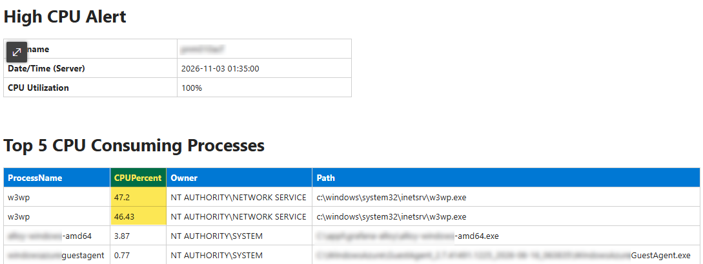

# CPU Utilization HIGH (>90%) + Email Notification

Continuously monitors for high CPU utilization (<90%) and writes data to log file and sends email alert with the following information:

<p align="left">
  
  <br/>
</p>

## Script Tasks
✅ Monitors CPU usage (5 Sec/Interval) and detects when utilization rises above 90%.<br>
✅ Captures the top 5 processes with high CPU usage.<br>
✅ Continuously logs high CPU events for later review and troubleshooting.<br>
✅ Email report to pre-defined email. 
## Script Permissions
🔴 <ins>Administrator</ins> Terminal Required!</span> 🔴

## Code Block

```powershell
Clear-Host

# SCRIPT NAME
$ScriptName = "High CPU Monitor"

# AM OR PM TIME INDICATOR FOR FILE AND FOLDER NAMING PURPOSES
$AmOrPm = Get-Date -UFormat %p

If ($AmOrPm -eq 'AM') {
    $AmPM = "am"
}
ElseIf ($AmOrPm -eq 'PM') {
    $AmPM = "pm"
}

# SCRIPT HOME FOLDER NAME AND DIRECTORY
$ScriptNameFull = "$ScriptName - $(Get-Date -f MM_dd_yyyy_hhmm)$AmPM"
$ScriptFolder = "$env:USERPROFILE\Desktop\PsHOME\$ScriptNameFull"

# CREATE SCRIPT HOME FOLDER
New-Item -Path $ScriptFolder -ItemType Directory -Force | Out-Null

# LOG FILE
$LogFile = "$ScriptFolder\HighCPU.log"

# EMAIL SETTINGS
$EmailEnabled = $true
$EmailCooldownMinutes = 5
$LastEmailTime = Get-Date "01/01/2000"

$SmtpServer = "smtp.mailserver.com"
$SmtpPort = 25
$From = "High-CPU-Alert@server.com"
$To = "user@user.com"

Write-Host ""
Write-Host "Monitoring CPU utilization..." -ForegroundColor Cyan
Write-Host "Log File: $LogFile" -ForegroundColor Cyan

if ($EmailEnabled) {
    Write-Host "Email Alerts: Enabled (Cooldown: $EmailCooldownMinutes minutes)" -ForegroundColor Cyan
}

Write-Host ""

function Get-TopProcesses {

    $Cores = (Get-CimInstance Win32_ComputerSystem).NumberOfLogicalProcessors

    Get-Counter '\Process(*)\% Processor Time' -ErrorAction SilentlyContinue |
    Select-Object -ExpandProperty CounterSamples |
    Where-Object {
        $_.Status -eq 0 -and
        $_.InstanceName -notin "_Total", "Idle", "System"
    } |
    Sort-Object CookedValue -Descending |
    Select-Object -First 5 |
    ForEach-Object {

        $BaseName = $_.InstanceName -replace '#\d+$', ''

        $Proc = Get-Process -Name $BaseName -ErrorAction SilentlyContinue |
        Sort-Object Id |
        Select-Object -First 1

        if ($Proc) {

            $Owner = try {
                $OwnerInfo = Get-CimInstance Win32_Process -Filter "ProcessId=$($Proc.Id)" |
                Invoke-CimMethod -MethodName GetOwner

                "$($OwnerInfo.Domain)\$($OwnerInfo.User)"
            }
            catch {
                "Unknown"
            }

            $Path = try {
                $Proc.MainModule.FileName
            }
            catch {
                "Access Denied"
            }

            [PSCustomObject]@{
                ProcessName = $_.InstanceName
                CPUPercent  = [math]::Round(($_.CookedValue / $Cores), 2)
                Owner       = $Owner
                Path        = $Path
            }
        }
    }
}

while ($true) {

    $CpuUsage = (
        Get-Counter '\Processor(_Total)\% Processor Time' -SampleInterval 1 -MaxSamples 5 |
        Select-Object -ExpandProperty CounterSamples |
        Select-Object -ExpandProperty CookedValue |
        Measure-Object -Average
    ).Average

    $CpuUsage = [math]::Round($CpuUsage, 2)

    if ($CpuUsage -ge 90) {

        $DateTime = Get-Date -Format 'yyyy-MM-dd HH:mm:ss'

        $TopProcesses = Get-TopProcesses

        Add-Content -Path $LogFile -Value ""
        Add-Content -Path $LogFile -Value "=========================================================="
        Add-Content -Path $LogFile -Value "Timestamp : $DateTime"
        Add-Content -Path $LogFile -Value "Server    : $env:COMPUTERNAME"
        Add-Content -Path $LogFile -Value "CPU Usage : $CpuUsage%"
        Add-Content -Path $LogFile -Value "=========================================================="

        $ProcessTable = $TopProcesses |
        Format-Table -AutoSize |
        Out-String

        Add-Content -Path $LogFile -Value $ProcessTable
        Add-Content -Path $LogFile -Value ""

        Write-Host "$DateTime - High CPU detected ($CpuUsage%). Logged to file." -ForegroundColor Red

        if (
            $EmailEnabled -and
            ((Get-Date) - $LastEmailTime).TotalMinutes -ge $EmailCooldownMinutes
        ) {

            $ProcessRows = foreach ($Process in $TopProcesses) {

@"
<tr>
    <td>$($Process.ProcessName)</td>
    <td>$($Process.CPUPercent)</td>
    <td>$($Process.Owner)</td>
    <td>$($Process.Path)</td>
</tr>
"@
            }

            $Body = @"
<html>
<head>
<style>
body {
    font-family: Segoe UI, Arial, sans-serif;
    font-size: 10pt;
}

table {
    border-collapse: collapse;
}

th {
    background-color: #0078D4;
    color: white;
    border: 1px solid #d0d0d0;
    padding: 6px;
    text-align: left;
}

td {
    border: 1px solid #d0d0d0;
    padding: 6px;
}

.summary {
    width: 540px;
    margin-bottom: 20px;
}

.processes {
    width: 100%;
}

h3 {
    font-family: Segoe UI, Arial, sans-serif;
}
</style>
</head>
<body>

<h1>High CPU Alert</h1>

<table class="summary">
<tr>
    <td><b>Hostname</b></td>
    <td>$env:COMPUTERNAME</td>
</tr>
<tr>
    <td><b>Date/Time (Server)</b></td>
    <td>$DateTime</td>
</tr>
<tr>
    <td><b>CPU Utilization</b></td>
    <td>$CpuUsage%</td>
</tr>
</table>

<br>

<h2>Top 5 CPU Consuming Processes</h2>

<table class="processes">

<tr>
    <th>ProcessName</th>
    <th>CPUPercent</th>
    <th>Owner</th>
    <th>Path</th>
</tr>

$($ProcessRows -join "`r`n")

</table>

</body>
</html>
"@

            try {

                Send-MailMessage `
                    -SmtpServer $SmtpServer `
                    -Port $SmtpPort `
                    -From $From `
                    -To $To `
                    -Subject "[High CPU Alert] - $env:COMPUTERNAME - $CpuUsage%" `
                    -Body $Body `
                    -BodyAsHtml

                $LastEmailTime = Get-Date

                Write-Host "Email alert sent." -ForegroundColor Yellow
            }
            catch {
                Write-Host "Failed to send email: $($_.Exception.Message)" -ForegroundColor Red
            }
        }
    }

    Start-Sleep -Seconds 5
}
```