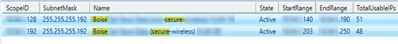

# DHCP String Search (Scopes Only!)

Text-based search for DHCP scopes.<br>
In this example, the search is for "Boise Wireless" with the following results:

<p align="left">
  
  <br/>
</p>

## Script Tasks
✅ Supports multi-word searches<br>
✅ Words can appear in any order<br>
✅ Exports results to a timestamped CSV in $ScriptFolder<br>
✅ Displays results in Out-GridView<br>
✅ Keeps proper numerical IP sorting using [version]

## Script Permissions
🔴 <ins>Administrator</ins> Terminal Required!</span> 🔴


## Code Block
```powershell

# --------------------------
# Create Script home folder
# --------------------------

# Scriptname
$ScriptName = "DHCP String Search"

# Script home folder name and directory
$ScriptNameFull = "$($ScriptName)-$((Get-Date -Format 'MM_dd_yyyy_hhmmtt').ToLower())"
$ScriptFolder   = "$env:USERPROFILE\Desktop\PsHOME\$ScriptNameFull"

# Create script home folder
$null = New-Item -Path $ScriptFolder -ItemType Directory -Force

# Output files
$ResultsCSV = "$ScriptFolder\$($ScriptNameFull)-CSVResults.csv"
$ResultsTXT = "$ScriptFolder\$($ScriptNameFull)-TXTResults.txt"

Clear-Host

$searchString = Read-Host "DHCP Scope String Search"

# Split input into individual search terms
$searchTerms = $searchString -split '\s+'

# Find matching scopes
$scopes = Get-DhcpServerv4Scope | Where-Object {

    $NameMatch = $true

    foreach ($term in $searchTerms) {
        if ($_.Name -notmatch [regex]::Escape($term)) {
            $NameMatch = $false
            break
        }
    }

    $NameMatch -or ($_.ScopeId -match [regex]::Escape($searchString))
}

# Check if any scopes were found
if ($null -eq $scopes) {

    Write-Host "`n$searchString Not Found!" -ForegroundColor Red

}
else {

    $Results = $scopes | ForEach-Object {

        # Fetch live stats for the current scope
        $stats = Get-DhcpServerv4ScopeStatistics -ScopeId $_.ScopeId

        [PSCustomObject]@{
            ScopeID        = $_.ScopeId
            SubnetMask     = $_.SubnetMask
            Name           = $_.Name
            State          = $_.State
            StartRange     = $_.StartRange
            EndRange       = $_.EndRange
            TotalUsableIPs = $stats.InUse + $stats.Free
            Reserved       = $stats.Reserved
            InUse          = $stats.InUse
            Free           = $stats.Free
            'InUse (%)'    = [int][math]::Round($stats.PercentageInUse)
        }

    } |
    Sort-Object { [version]$_.ScopeID.IPAddressToString }

    # Export results to CSV
    $Results | Export-Csv -Path $ResultsCSV -NoTypeInformation

    Write-Host ""
    Write-Host "CSV exported to:" -ForegroundColor Green
    Write-Host $ResultsCSV -ForegroundColor Cyan
    Write-Host ""

    # Display results
    $Results | Out-GridView -Title "DHCP Scope Search Results"
}
```