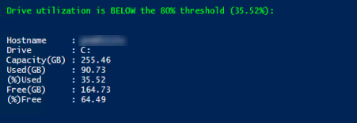

# Disk Utilization

Gathers disk information for a specified disk drive entered at the prompt. 

<p align="left">
  
  <br/>
</p>

## Script Tasks
✅ Prompts you for a drive letter and gathers disk space info for that drive.<br>
✅ Calculates drive's total size, used space, free space, and percentage of disk 
utilization.<br>
✅ Displays status report and warns you if the drive is using more than 80% of available space.<br>

## Script Permissions
🔵 Standard non-admin access 🔵

## Code Block

```powershell
Clear-Host

$DriveletterInput = Read-Host "Enter Drive Letter"
$Driveletter = "$($DriveletterInput.Trim().ToUpper()):"

Clear-Host

# 1. GET DATA ONCE
$DriveSearch = Get-CimInstance Win32_LogicalDisk -Filter "DeviceID = '$Driveletter'"

 # 2. CALCULATE DATA locally
    $UsedGB = [math]::Round(($DriveSearch.Size - $DriveSearch.FreeSpace) / 1GB, 2)
    $SizeGB = [math]::Round($DriveSearch.Size / 1GB, 2)
    $PercentUsed = [math]::Round(($UsedGB / $SizeGB) * 100, 2)

if ($DriveSearch) {
   
    # 3. DISPLAY TABLE
     if ($PercentUsed -lt 80) {
    Write-Host "`nDrive utilization is BELOW the 80% threshold ($PercentUsed%):" -ForegroundColor Green
    $DriveSearch | Select-Object @(
        @{L = "Hostname";     E = { $env:COMPUTERNAME }},
        @{L = "Drive";        E = { $_.DeviceID }},
        @{L = "Capacity(GB)"; E = { $SizeGB }},
        @{L = "Used(GB)";     E = { $UsedGB }},
        @{L = "(%)Used";      E = { $PercentUsed }},
        @{L = "Free(GB)";     E = { [math]::Round($_.FreeSpace / 1GB, 2) }},
        @{L = "(%)Free";      E = { [math]::Round(($_.FreeSpace / $_.Size) * 100, 2) }}
    ) | Format-List
    }

    # 4. THRESHOLD CHECK
    elseif ($PercentUsed -gt 80) {
        Write-Host "`n================= WARNING =================" -ForegroundColor Red
        write-host "Used space is GREATER than the 80% ($PercentUsed%)" -ForegroundColor yellow
        $DriveSearch | Select-Object @(
        @{L = "Hostname";     E = { $env:COMPUTERNAME }},
        @{L = "Drive";        E = { $_.DeviceID }},
        @{L = "Capacity(GB)"; E = { $SizeGB }},
        @{L = "Used(GB)";     E = { $UsedGB }},
        @{L = "(%)Used";      E = { $PercentUsed }}
    ) | Format-List
    }

} else {
    Write-Host "Drive '$($Driveletter)' not found!" -ForegroundColor Yellow
}
```