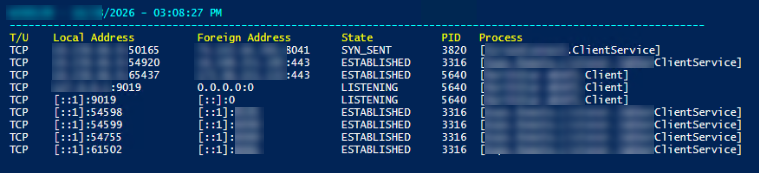

# Port & Process Monitor (STRING)

Actively query network processes based on text entered from string.<br>
Refreshes results every 1 second, but can be modified by changing the `start-sleep` setting. 

<p align="left">
  
  <br/>
</p>


## Script Tasks
✅ Prompts for a search string and filters active connections based on textvalue (port, IP address, PID, or process name).<br>
✅ Displays matching network connections along with the associated process name and PID.<br>
✅ Continuously refreshes the display every 250 milliseconds to provide near real-time monitoring.<br>
✅ Shows the hostname, date, and time while updating the screen until manually stopped (Ctrl+C).

## Script Permissions
🔵 Standard non-admin access

## Code Block

```powershell
Clear-Host

$Search = Read-Host "Search String"
$HostName = $env:COMPUTERNAME

while ($true) {

    $results = @()

    netstat -ano |
        ForEach-Object {
            $line = $_.ToString().Trim()

            if ($line -match '^(TCP|UDP)') {

                $ProcessId = ($line -split '\s+')[-1]
                $processName = (Get-Process -Id $ProcessId -ErrorAction SilentlyContinue).ProcessName

                if (
                    $line -like "*$Search*" -or
                    $processName -like "*$Search*"
                ) {
                    $results += "$line  [$processName]"
                }
            }
        }

    if ($results.Count -gt 0) {

        $Header = "$HostName - $(Get-Date -Format 'MM/dd/yyyy') - $(Get-Date -Format 'hh:mm:ss tt')"

        Clear-Host

        Write-Host "`n$Header" -ForegroundColor Cyan
        Write-Host "---------------------------------------------------------------------------------------------------------------" -ForegroundColor Cyan
        Write-Host "T/U    Local Address          Foreign Address        State           PID   Process" -ForegroundColor Yellow


        $results | ForEach-Object { Write-Host $_ }
    }

    Start-Sleep -Milliseconds 250
}
```